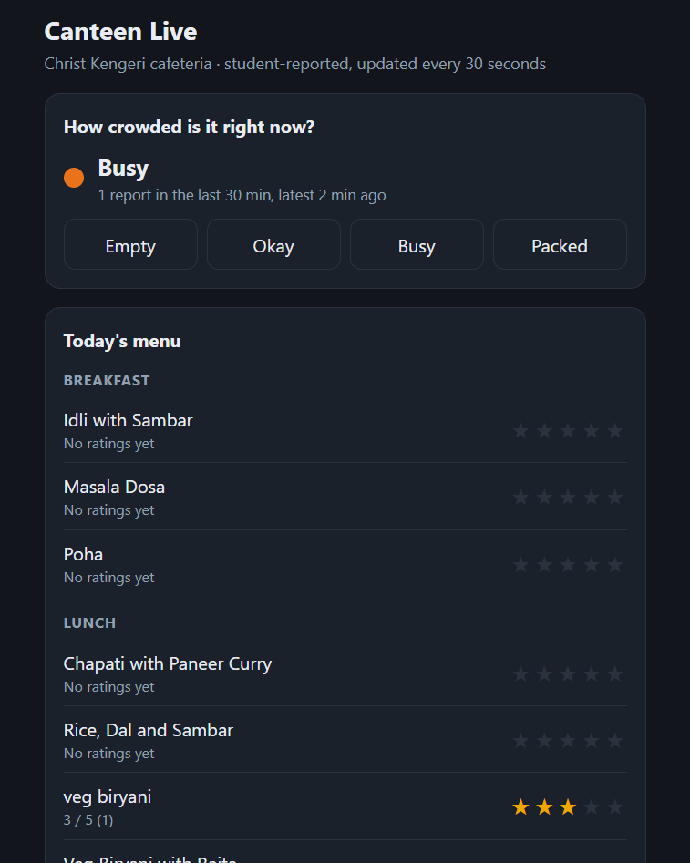

# Canteen Live

**A serverless web app that tells students how crowded the cafeteria is, what's on today's menu, and how good the food is, before they walk over.**

Built for the **AWS ShipIt Challenge** by **Techfest 2026-27, IIT Bombay** in collaboration with **AWS**, on the **AWS Free Tier**.

**Live demo:** https://d1zfmw732536j6.cloudfront.net
**Demo video:** [Watch the 60-90 second demo] https://canva.link/32pdx28kugwn2ml

> Menu items are stored per day. If the menu looks empty when you visit, just add a few of today's dishes with the form on the page, or tap a crowd button to see the status update.



---

## The AWS ShipIt Challenge

The AWS ShipIt Challenge is an online developer challenge run by Techfest 2026-27, IIT Bombay with AWS (17-27 November 2026). The task: build a working project on the AWS Free Tier that solves a real problem on your own college campus, and show practical use of AWS services.

What I did to take part:
- Created my **AWS Builder Center** profile and claimed my alias (`bugdriven`)
- Completed **student verification** through SheerID
- Created an **AWS account**, set a zero-spend budget alert, and deployed this project to it
- Built, tested and shipped a working app, then recorded a short demo video for the submission

## The problem

My campus, CHRIST (Deemed to be University) Kengeri Campus, is on the outskirts of Bengaluru, on Mysore Road near Kumbalgodu. According to the university's own hostel information, the hostels on campus do not have a mess facility, so students rely on the campus cafeteria or outside food.

That means students often walk to the cafeteria without knowing whether it's packed or what's being served, which wastes time between classes. There is also no single place to see today's menu or what other students think of it.

**Why I chose it:** I'm a student on this campus, and the cafeteria is part of every day here. Guessing whether it's packed, or what's being served, is a small daily annoyance, and I wanted to fix it with something real instead of just putting up with it.

## The solution

Canteen Live is a small web app that works in any phone browser, with no login or install.

- **Live crowd status.** Students tap *Empty, Okay, Busy* or *Packed*. The app averages reports from the last 30 minutes, so old information disappears on its own.
- **Today's menu.** Anyone can add dishes under Breakfast, Lunch, Snacks or Dinner. Duplicates are blocked.
- **Ratings.** Students rate each dish from 1 to 5 stars and the running average is shown.
- **Always fresh.** The page refreshes every 30 seconds.

## Architecture

```
Student's phone
   |
   |-- HTTPS --> Amazon CloudFront --> Amazon S3 (private bucket: index.html, config.js)
   |
   '-- HTTPS --> Amazon API Gateway (HTTP API) --> AWS Lambda (Python 3.12) --> Amazon DynamoDB
```

| AWS service | What it does here |
|---|---|
| **Amazon S3** | Stores the website files. The bucket is private. |
| **Amazon CloudFront** | Serves the site over HTTPS. Uses Origin Access Control, so only CloudFront can read the bucket. |
| **Amazon API Gateway** | Public HTTP API, throttled to 10 requests/second to limit abuse. |
| **AWS Lambda** | One Python function (`app.py`) that handles all four API routes. |
| **Amazon DynamoDB** | Stores menu items, ratings and crowd reports (on-demand billing). The TTL feature deletes old crowd reports automatically. |
| **AWS CloudFormation / SAM** | The whole stack is defined in `template.yaml`, so it deploys with one command. |
| **AWS Budgets** | A zero-spend budget alert guards against surprise costs. |

Everything is serverless and pay-per-use, so it stays inside the Free Tier for a campus-sized project.

## API

| Method | Path | Body | Purpose |
|---|---|---|---|
| GET | `/status` | none | Current crowd level and today's menu with ratings |
| POST | `/crowd` | `{"level": "empty\|moderate\|busy\|packed"}` | Report how crowded the cafeteria is |
| POST | `/menu` | `{"name": "Masala Dosa", "meal": "breakfast"}` | Add a dish to today's menu |
| POST | `/rate` | `{"itemId": "...", "stars": 1-5}` | Rate a dish |

**Data model.** One DynamoDB table with `pk` / `sk` keys. Crowd reports use `pk = CROWD` and expire through TTL. Menu items use `pk = MENU#<date>` (in IST) and hold their rating totals.

## Project structure

```
app.py          Lambda backend (all routes)
template.yaml   AWS SAM template (S3, CloudFront, API Gateway, Lambda, DynamoDB)
index.html      Frontend (single page, mobile-first, light and dark mode)
config.js       Holds the API URL for the frontend
test_app.py     Automated backend tests (moto fake DynamoDB)
screenshots/    Images used in this README
```

## Run the tests locally

```
pip install moto boto3 pytest
pytest
```

The tests cover crowd averaging, menu rules, duplicate blocking, rating math and input validation.

## Deploy your own copy

You need an AWS account. The easiest way is **AWS CloudShell** (the terminal icon in the AWS console), which already has the AWS CLI and SAM.

1. Upload this folder to CloudShell (Actions, then Upload file) and unzip it.
2. Deploy:
   ```
   cd canteen-live
   sam deploy --guided
   ```
   Use the stack name `canteen-live` and accept the defaults. Answer `y` when it warns that the API has no authentication (the app is public by design).
3. Connect the site to the API and upload the website files:
   ```
   API=$(aws cloudformation describe-stacks --stack-name canteen-live --query "Stacks[0].Outputs[?OutputKey=='ApiUrl'].OutputValue" --output text)
   BUCKET=$(aws cloudformation describe-stacks --stack-name canteen-live --query "Stacks[0].Outputs[?OutputKey=='BucketName'].OutputValue" --output text)
   sed -i "s|window.API_URL = \"\"|window.API_URL = \"$API\"|" config.js
   aws s3 cp index.html s3://$BUCKET/
   aws s3 cp config.js s3://$BUCKET/
   ```
4. Open the `SiteUrl` output of the stack to see your site.

To remove everything: `aws s3 rm s3://$BUCKET --recursive` and then `sam delete`.

## What I learned

- How serverless pieces fit together: S3 and CloudFront for the site, API Gateway and Lambda for the API, DynamoDB for data
- **Infrastructure as code:** describing a whole system in one SAM/CloudFormation template and deploying it with a single command
- Keeping an S3 bucket private and serving it safely through CloudFront with Origin Access Control
- Using DynamoDB's TTL feature to expire data automatically, instead of writing cleanup code
- Designing for cost: on-demand billing, API throttling and a zero-spend budget alert
- Testing Lambda code locally with a fake DynamoDB before deploying
- Deploying from AWS CloudShell and reading CloudFormation events when a resource takes a while to create
- Getting set up in the AWS Builder Center as a student builder

## Limitations and next steps

This is a prototype. Reports are anonymous, so they could be spammed. Throttling and a daily menu limit reduce this, but it isn't fully prevented.

Ideas for the future:
- Login with a college email using Amazon Cognito to prevent fake reports
- A "best time to go" suggestion based on past crowd data
- A CloudWatch dashboard showing daily usage
- Extending it to other CHRIST campuses and other campus facilities, such as the library

## Built with

Python 3.12, vanilla HTML/CSS/JavaScript, and AWS. The code was written with AI assistance, and I deployed, tested and ran it on my own AWS account.

## Author

**Kanak Sethi**, CHRIST (Deemed to be University), Kengeri Campus, Bengaluru
AWS Builder Center alias: `bugdriven`

Thanks to **Team Techfest 2026-27, IIT Bombay** and **AWS** for organising the AWS ShipIt Challenge.
